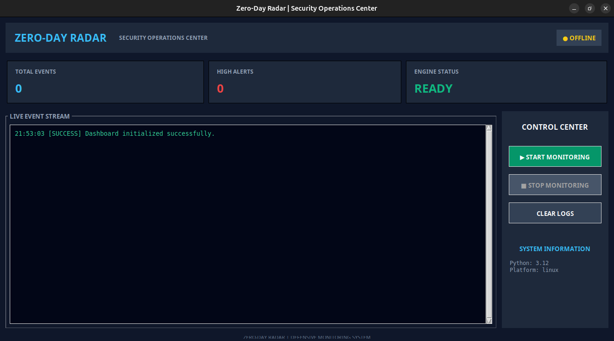
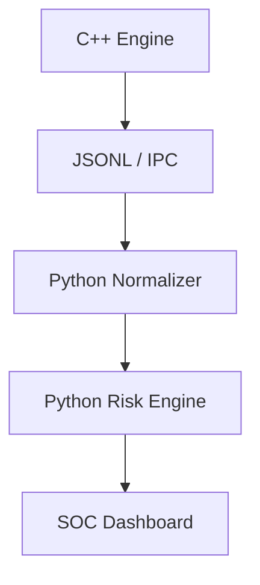

# 🛡️ Zero-Day Radar v3.3.0


> Status: Reliable Beta
> Architecture: Hybrid C++17 & Python
> Platform: Linux
> Automated Tests: 43/43 Passed

## About the Project

Zero-Day Radar is a lightweight cybersecurity
monitoring and threat detection prototype designed
for real-time security telemetry, behavioral
indicators, and event correlation.

## SOC Dashboard



## Key Features

- Real-time decoy file monitoring using Linux inotify.
- Shannon entropy-based file analysis.
- TCP listener monitoring.
- Structured JSONL security events.
- Event normalization and severity scoring.
- Sliding-window risk correlation.
- Entity-based risk isolation.
- Correlation alert deduplication.
- Thread-safe risk processing.
- Critical severity support.
- Real-time SOC Dashboard.

## System Architecture



## Risk Correlation

Default correlation window: 60 seconds.
Default alert threshold: 50 points.
Maximum stored events: 1000.

| Severity | Score |
|----------|-------|
| LOW      | 10    |
| MEDIUM   | 25    |
| HIGH     | 50    |
| CRITICAL | 75    |

## Installation

Ubuntu dependencies:

```bash
sudo apt install git build-essential python3 python3-venv python3-tk
```

Requirements:

- Linux (Ubuntu recommended)
- GCC with C++17 support
- GNU Make
- Python 3 with Tkinter
- pytest for automated testing

```bash
git clone https://github.com/aouamchawki-3A/zero-day-radar.git
cd zero-day-radar
python3 -m venv venv
source venv/bin/activate
python -m pip install pytest
make core
```

## Run the SOC Dashboard

Review radar.conf and configure SCAN_PATH,
DECOY_PATH and LOG_FILE before monitoring.

```bash
./venv/bin/python dashboard.py
```

## Automated Testing

```bash
make test
./venv/bin/python -m pytest tests/ -v
```

| Test Suite | Passed |
|------------|--------|
| C++ Engine | 12/12 |
| Entropy Unit Tests | 7/7 |
| Python Tests | 24/24 |
| Total | 43/43 |

Manual SOC dashboard validation also passed,
including real-time detection, risk correlation,
event counting, and monitoring shutdown.

## Current Limitations

- Automatic quarantine is not implemented.
- High entropy alone does not prove malicious activity.
- Risk scores are heuristic indicators.
- Zero-day exploit detection is not guaranteed.
- This project is a security monitoring prototype.

## Future Roadmap

- SQLite event storage.
- Real-time security charts.
- Behavioral anomaly detection.
- Advanced network monitoring.
- Security report generation.
- Controlled file quarantine.

## Development Philosophy

Reliability. Performance. Modularity. Security.

Built for continuous improvement and practical
cybersecurity research.
